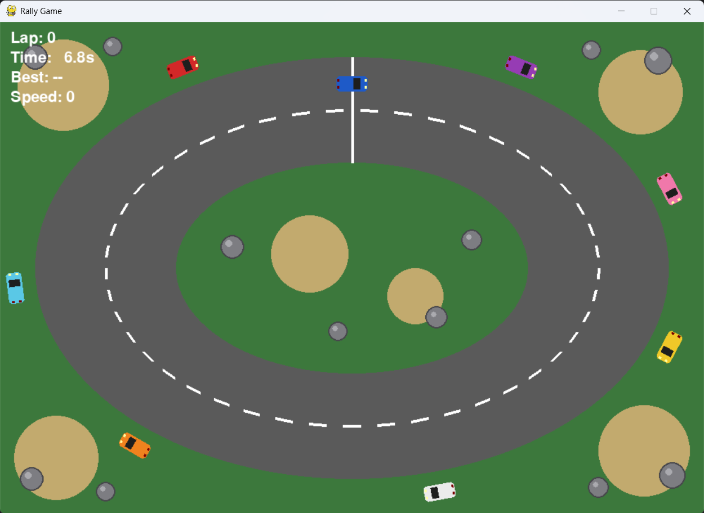

# 🏎️ Rally Game

A 2D top-down rally car game built with **Python** and **Pygame**. Drive around the track, pass every checkpoint, avoid the rocks and parked cars, and try to beat your best lap time.



## Features

- **Car handling**: acceleration, braking, reversing and steering that only works while the car is moving
- **Two-lane road**: a dashed white line splits the track into two lanes
- **Different surfaces**: normal road, slow grass and very slow sand
- **Obstacles**: rocks and parked cars. Hit one and you restart from the start line
- **Checkpoints and laps**: checkpoints must be passed in order, so there are no shortcuts
- **HUD**: lap count, current lap time, best lap and speed
- **Pause**: press P to freeze the game and press P again to carry on
- **Car lights**: headlights at the front, and brake lights that glow brighter when you brake

## How to run

1. Install [Python](https://www.python.org/downloads/) 3.9 or newer.
2. Download or clone this repository:
   ```
   git clone https://github.com/itznisila/rally-game.git
   cd rally-game
   ```
3. Install the requirements:
   ```
   pip install -r requirements.txt
   ```
4. Start the game:
   ```
   python rally_game.py
   ```

## Controls

| Key | Action |
|---|---|
| ↑ | Accelerate |
| ↓ | Brake / reverse |
| ← → | Steer |
| P | Pause / resume |
| ESC | Quit |

## How it works

| Part | What it does |
|---|---|
| Track | Drawn in code as an oval road on a green background, so no image files are needed |
| Surfaces | The game reads the colour of the pixel under the car to decide how much to slow it down |
| Obstacles | Rocks and parked cars are stored as circles, and touching one restarts the car |
| Checkpoints | Points around the track measured by distance from the car |
| Game loop | Runs 60 times per second: read keys, update speed, move, check crashes, check laps, draw (skipped while paused) |

## Project structure

```
rally-game/
├── rally_game.py       # the whole game
├── requirements.txt    # Python packages needed
├── screenshot.png      # screenshot used in this README
└── README.md
```

## Future improvements

- Car sprites and a camera that follows the car on a bigger map
- Drifting and more road surfaces such as mud and snow
- AI opponents and multiple stages
- Engine sounds, skid marks and dust
- Light cone from the headlights
- Time penalty for crossing the white lane line

## Author

**Nisila Dinod**
GitHub: [@itznisila](https://github.com/itznisila)